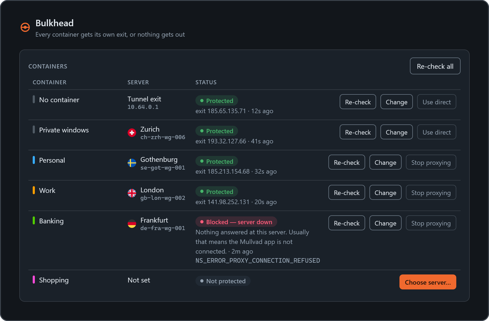
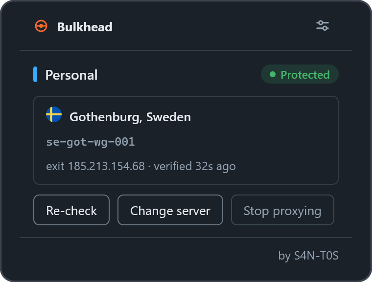
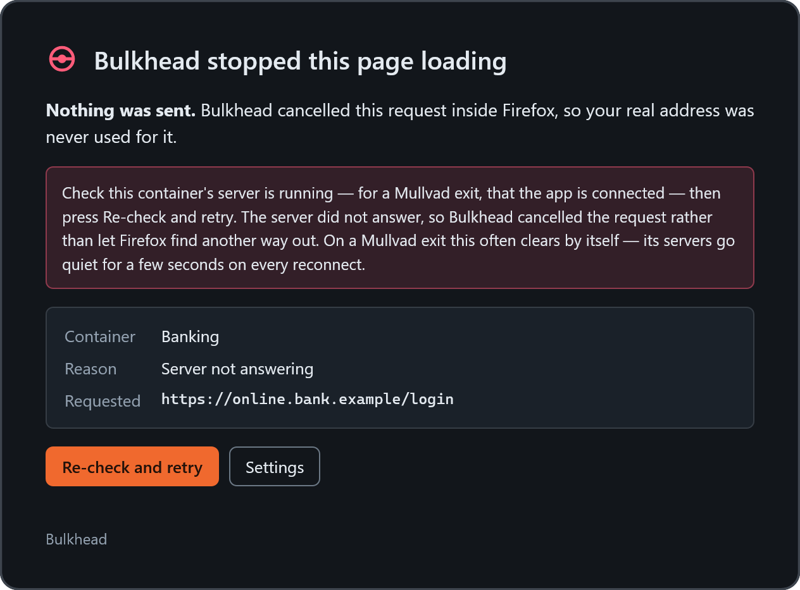

# Bulkhead

**Mullvad servers per Firefox container, with a kill switch.**

Bulkhead is a Firefox companion for the Mullvad VPN app. It gives each
Firefox container its own Mullvad server, so Work, Banking and Personal tabs
browse from different IP addresses at the same time. If a container's server
stops answering, or its traffic comes out at the wrong server, that
container is blocked until the server checks out again.

- All of Mullvad's servers, searchable, with favourites and recents
- Each exit verified with Mullvad's own exit check, not just pinged
- Tabs outside any container, and private windows, can be pinned too
- Your own SOCKS5 servers work as well. IVPN support is planned.

<p align="center">
  <a href="https://addons.mozilla.org/firefox/addon/bulkhead/"></a>
</p>

<p align="center">
  
</p>

Unofficial. Not affiliated with Mullvad VPN AB.

## Why not just set a proxy per container?

You can. Multi-Account Containers has a proxy field and a Mozilla VPN
location picker, and Sidebery and FoxyProxy can map containers to proxies.
All three hand Firefox a proxy and leave it there. Sidebery can look up a
container's IP when you ask; none of them block anything. MAC also skips
any request that has no tab, so a container's service workers go out
without its proxy. Bulkhead routes by container, tab or not.

| | Bulkhead | Proxy setting in MAC, Sidebery or FoxyProxy |
|---|:-:|:-:|
| Proxy per container | ✓ | ✓ |
| Mullvad's server list, kept current | ✓ | |
| Checks that traffic exits at the server you picked | every 10 min, and after errors | |
| Blocks a container whose server is down, unchecked or wrong | ✓ | |
| Blocks traffic another extension reroutes or sends direct | ✓ | |
| After a restart, blocks each container until its server is checked | ✓ | |
| Tells you which container was blocked and why | ✓ | |
| Warns when your server is retired, offers a nearby one | ✓ | |
| Detects DNS-over-HTTPS being switched back on | ✓ | |

## Works with Multi-Account Containers

Use [Multi-Account Containers] (MAC) to choose which sites open in which
container, and Bulkhead to choose where each container exits. MAC's site
assignments only move tabs between containers, so the two work together.

Don't also give a Bulkhead container a proxy or a Mozilla VPN location in
MAC. When two extensions proxy the same container, the one that loaded
last wins:

- **MAC last:** Bulkhead blocks the container's traffic as "another proxy",
  since it would no longer leave through your server.
- **Bulkhead last:** its route wins and MAC's proxy plays no part.
- **MAC's proxy permission alone**, with no proxy set, changes nothing.
- **FoxyProxy and Sidebery** use the same proxy API and behave the same way.
- **A proxy for all of Firefox**, or for requests outside containers, set
  by any extension that loaded after Bulkhead, also takes Bulkhead's server
  checks. Every Bulkhead container then stays blocked as "another proxy"
  until it's off.

[Multi-Account Containers]: https://addons.mozilla.org/firefox/addon/multi-account-containers/

## Features

<p align="center">
  
  &nbsp;
  
</p>

- **Toolbar popup** for the current tab: its server, whether it's verified,
  the exit IP, and a quick switcher. Servers another container already uses
  are marked, since two containers on one server share an IP.
- **Kill switch.** A container is blocked while its server is down,
  unchecked, or exiting somewhere else. Strict mode (on by default) also
  blocks requests Firefox can't tie to a container.
- **Tunnel exit.** Pin a context to `10.64.0.1` to follow whichever server
  the Mullvad app is connected to. It's unreachable the moment the app
  disconnects.
- **No container and private windows** can each get a server, or stay
  direct. Private windows need Run in Private Windows allowed in
  about:addons. Pinning the no-container context also covers Bulkhead's own
  server-list fetch.
- **Custom exits**: your own SOCKS5 servers (an SSH tunnel, a VPS), with
  the same checks. Bulkhead can't vouch for where a foreign server exits,
  and says so.
- **Retired servers**: the list refreshes daily. If your server leaves it,
  you get a warning and a one-click move to an unused one in the same city
  or country.
- **Blocked page** naming the container, the reason and the requested
  address, instead of a blank network error.
- **Toolbar badge**: nothing when verified, `?` while checking, `!` when
  blocked.
- **Optional hardening**: WebRTC forced through the proxy, prefetching and
  prerendering off. Restored exactly when you turn it off.
- **Allow loopback** (off by default) for sign-in flows that hand a token to
  an app on 127.0.0.1.

## Requirements

- Firefox 142 or later, desktop.
- For Mullvad servers: a Mullvad account and the app connected. The
  per-server SOCKS5 proxies only exist inside the tunnel. Custom exits need
  neither.
- Two `about:config` settings, which the settings page walks you through:
  `network.proxy.failover_direct = false` and `network.trr.mode = 5`
  (DNS-over-HTTPS off, so names resolve through each container's server).

## Limits

- **Requests that find a server dead.** They were sent while the server
  still checked out, so they end in a network error instead of the blocked
  page. Nothing leaks: Firefox doesn't fall back to direct, and no other
  proxy sits behind the exit.
- **DNS-over-HTTPS.** Bulkhead can't switch it off for you. It notices
  within ten minutes when DoH starts answering lookups and marks the setup
  incomplete, but it can't prove DoH is off.
- **Startup.** Requests Firefox makes before Bulkhead's background page runs
  are seen by nothing.
- **Mozilla's own sites.** Firefox hides addons.mozilla.org and the other
  sites it restricts from extensions' request checks. Once Bulkhead has
  loaded its settings, it routes them through the container's server but
  can't block them: before that they go out directly, and while a server
  is unchecked or wrong they go out through it anyway. Another proxy
  extension taking them over goes unnoticed.
- **Other extensions' DNS lookups.** `dns.resolve()` bypasses every proxy.
  uBlock Origin's CNAME uncloaking was the known case, fixed in uBO 1.60.0.
  On older uBO, untick "Uncloak canonical names".
- **Firefox launched by an app excluded from Mullvad's split tunnel** (say,
  a Steam link with Firefox closed) is outside the tunnel too. Every Mullvad
  exit stays blocked, and anything unmanaged uses your real connection.
  Close Firefox and start it yourself.
- **Bulkhead disabled, crashed or uninstalled.** Nothing protects you then.

There is no "leak test" button. Three detectors were built, and all three
gave the same answer with `failover_direct` on and off. A check that can say
"safe" while you leak is worse than none, so none shipped.

### Does a dead proxy leak?

Not on current Firefox, for extension-set proxies. The widely repeated
fallback to DIRECT
([bug 1528873](https://bugzilla.mozilla.org/show_bug.cgi?id=1528873)) is
gated behind `network.proxy.failover_direct`, a build flag and
`LoadBeConservative()`, which Firefox sets on its own internal requests, not
on page loads. Four measured setups (black-holed and refusing proxies, pref
on and off) produced zero escapes; see `test/e2e/transition.mjs`. Setting
the pref to `false` is still cheap insurance, but Bulkhead doesn't rely on it.

## How it works

```
proxy.onRequest        container -> [SOCKS5 ProxyInfo, null] from an
                       in-memory map. Runs first. Can assign, cannot block.

webRequest.onBefore    decide(state, request + route) -> allow | block.
                       Blocking listener, the only authority.

webRequest.onError     hard proxy errors mark the server down at once;
                       timeouts, resets and refusals schedule a check.

alarms                 re-check failed servers every 30 s, healthy ones
                       every 10 min, refresh the server list daily.
```

Every allow/block rule is one pure function in [`src/decide.js`](src/decide.js),
with no I/O, clock or browser APIs, so it can be tested exhaustively.

- **Health is never saved.** After a restart every server starts unchecked,
  which blocks.
- **Blocked until settings load**, so session restore can't slip out direct.
- **Checks compare exit names.** `am.i.mullvad.net` reports which relay
  answered (`se-got-wg-socks5-001`). Any other answer blocks the container.
- **Every request extensions can see is route-checked** against the proxy
  Firefox reports for it. Anything but the container's own server is
  blocked as `rerouted`, including no proxy at all. Loopback and cache-only
  loads never get one, so they are exempt. A request Firefox reports before
  it has a route, as tracking protection does with what it cancels, is
  blocked but not flagged or listed. A takeover in the same millisecond as
  Bulkhead's routing looks the same for that one request. Server checks carry
  no tab, so they can't see a takeover that only touches tabs.
- **Nothing sits behind the exit.** The proxy list ends in `null`, so a
  refused server fails outright instead of falling back to a system, PAC or
  other extension's proxy.
- **A check counts only if it used the server under test**, judged by the
  route Firefox reports for it. A check another proxy took blocks the
  container as "another proxy", not as a dead server.
- **Checks can't be forged.** Only a single-use token the background is
  holding, on the check endpoint, gets a check's routing. A page pasting
  the marker gets nothing.
- **Proxy hosts are IP literals** (`10.124.x.x`), resolved once when you
  assign them, so your resolver never learns which container uses which
  server.
- **`proxyDNS` and a per-container `connectionIsolationKey`** on every
  request.
- **No runtime dependencies and no build step.** `src/` is what ships.

## Development

Node 24 or later, and npm. On Windows, also 7-Zip on PATH
(`scoop install 7zip`): `npm run setup` unpacks the Firefox installer
instead of running it, after checking Mozilla's published SHA-256.

```
npm install
npm run setup        # Firefox Developer Edition into .cache/firefox/
npm start            # web-ext on that Firefox, fresh temp profile
```

`npm start` always uses a fresh profile. A reused profile keeps the old
permission grants, so a permission added to the manifest later stays
silently missing. The temp profile also gets `failover_direct=false` and
`trr.mode=5`.

| script | |
|---|---|
| `npm test` | unit tests (`node:test`) |
| `npm run test:coverage` | unit tests with coverage |
| `npm run test:e2e` | real Firefox, real relays |
| `npm run lint` | eslint |
| `npm run lint:amo` | addons-linter, must be 0 errors, warnings and notices |
| `npm run typecheck` | tsc over JSDoc, no emit |
| `npm run build` | `dist/bulkhead-<version>.zip` |

## Testing

Unit tests cover `decide()` exhaustively, including a sweep over every
combination of startup state, strict mode, health, attribution, request
type and route, asserting nothing defaults to allow.

`npm run test:e2e` drives a real Firefox with a self-test appended to the
background page. Cases that need live relays detect the Mullvad tunnel and
skip without it, which is how CI runs them. To test the declared minimum,
point it at another build:

```
FIREFOX_CHANNEL=release FIREFOX_VERSION=142.0 npm run setup
FIREFOX_BINARY=.cache/firefox/142.0-win64/core/firefox.exe npm run test:e2e
```

Passes on Firefox 142 (the minimum), ESR 153 and Developer Edition 160,
with live relays:

| case | result |
|---|---|
| dead proxy (`10.124.255.254`) | navigation aborted, reason `proxy-down`, blocked page shown |
| server switched mid-check | new server checked fresh, never inherits the old result |
| live relay | `up`, traffic passes |
| wrong exit configured | `misrouted`, blocked |
| nothing managed | extension inert |
| no container on the tunnel exit, tunnel down | tabs and the server-list fetch blocked |
| no container on the tunnel exit, tunnel up | verified, traffic passes |
| hardening on, then off | applied, then fully restored |
| loopback from a blocked container | blocked with the toggle off, reaches a local server with it on |
| custom exit, nothing listening | `down`, blocked |
| custom exit, live SOCKS server | `up`, verified through the exit |
| another extension takes over a container's route, or strips it | blocked, reason `rerouted`, nothing reaches the other proxy or goes direct |
| exit dies with another extension's proxy behind it | fails, server marked `down`, nothing reaches the other proxy |
| another extension takes Bulkhead's own server check | stopped before it connects, container blocked as "another proxy", not as a dead server |

`node test/e2e/transition.mjs --failover-direct=true` is a manual check of
the moment a tunnel drops: it streams exit checks, disconnects through the
`mullvad` CLI and counts any request that escapes. It needs the CLI and a
logged-in app, and puts the tunnel back as it found it.

By hand: give two containers different servers and confirm on
`https://am.i.mullvad.net/json` that they differ. Disconnect Mullvad and
reload; you should get the blocked page. Finish with a look at
`about:networking#dns` for lookups that shouldn't be there.

## Roadmap

- **IVPN**, the closest match to Mullvad: an unauthenticated SOCKS5 proxy
  inside the tunnel for every server, and a public server list.

## Security

See [SECURITY.md](SECURITY.md). Anything that gets a managed context's
traffic onto the network without its assigned exit is the report I most
want.

## Credits

By [S4N-T0S](https://s4nt0s.eu). Flags from
[circle-flags](https://github.com/HatScripts/circle-flags) (MIT), vendored in
`src/flags/`. "Mullvad" is used only to describe compatibility.

## License

GPL-3.0-only. See [LICENSE](LICENSE).
